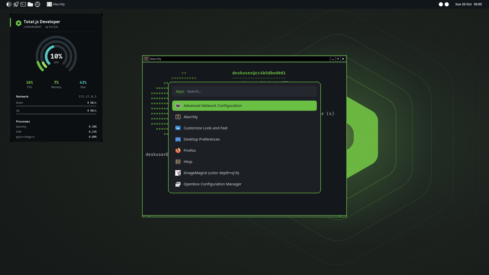
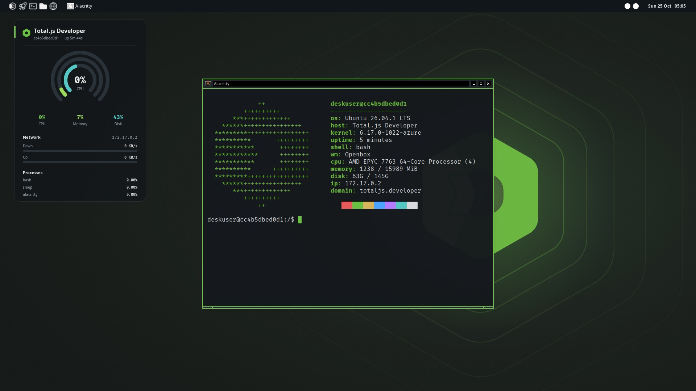
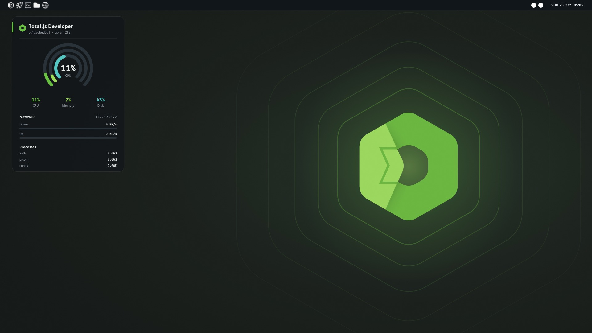

<p align="center"></p>

<h1 align="center">Total.js Developer</h1>

<p align="center"><b>A complete development environment for <a href="https://www.totaljs.com">Total.js</a>, installed in minutes.</b><br>An Ubuntu remix for virtual machines and computers, with a desktop or only the command line.</p>

<p align="center">
  <a href="https://github.com/totaljs-es/developer-distros/actions/workflows/check.yml"></a>
  <a href="https://github.com/totaljs-es/developer-distros/actions/workflows/package-repo.yml"></a>
  <a href="https://github.com/totaljs-es/developer-distros/actions/workflows/iso-ubuntu.yml"></a>
  <a href="LICENSE"></a>
</p>

> [!NOTE]
> **The Ubuntu edition is in testing.** The packages, the repository and the installation already work and are tested on amd64 and arm64, with a desktop and with only the command line. Total.js Developer is an Ubuntu remix: it is not an official Ubuntu release and it is not endorsed by Canonical. Its ISO is a modified image that carries marks of Ubuntu, and Canonical has to approve a modified image that carries its marks: **we asked on 2026-10-25 and the answer is pending**. Until then, the installation that is fully ours is the official Ubuntu Server ISO plus a small seed (see [the installation guide](docs/install.md)). If you find something that does not work, [open an issue](https://github.com/totaljs-es/developer-distros/issues): it helps to leave this edition as it should be.

<p align="center"></p>

## What you get

- **Node.js** (LTS) with **Total.js 5** and **Total.js 4**, `npm`, `pnpm` and `yarn`, and **fnm** to change the version of Node.js per project.
- **Code**, the Total.js editor in the browser, and **Flow**, to program with diagrams.
- **PostgreSQL** with **pgAdmin**, and a reverse proxy: every project has its own address, `my-project.totaljs.developer`.
- **Docker** with Compose, Git, SSH, `ufw` and `fail2ban`, and the usual tools of the command line.
- **Total.js Center**, the front door at `https://totaljs.developer`: the state of the services, your projects and how to connect to the database.
- In the **desktop edition**: an Openbox desktop with the look of Total.js, Firefox, Google Chrome, a terminal, a file manager, a widget on the wallpaper and twelve wallpapers.

## Install

Download **one ISO**, start a machine with it, choose the desktop or the server edition in the menu, and answer the usual questions of the installer. The rest
installs by itself. It needs an internet connection, in a virtual machine and on a computer.

1. Download the ISO for your processor from the [releases](../../releases): `totaljs-developer-amd64.iso` (Intel and AMD) or `totaljs-developer-arm64.iso` (ARM, such as UTM or Parallels on a Mac with Apple Silicon), and `SHA256SUMS`.
2. Attach the ISO to a virtual machine (4 GB of memory, 30 GB of disk), or write it to a USB stick.
3. Start it, choose **desktop edition** or **server edition**, and install.

**[Installation guide](docs/install.md)**. If you prefer the official ISO of Ubuntu Server, unmodified, the same release has a small seed image for each edition to
put next to it.

## Your first minutes

| Open | What it is |
| --- | --- |
| `https://totaljs.developer` | Total.js Center |
| `https://code.totaljs.developer` | Code |
| `https://flow.totaljs.developer` | Flow |
| `https://pgadmin.totaljs.developer` | pgAdmin |

The names are answered by the machine itself: there is nothing to configure. The first time, the services download their images, and Total.js Center shows when each one is ready.
**[How to use it](docs/using.md)**.

<p align="center"> </p>

## How it is built

Total.js Developer does not fork or patch Ubuntu. It is a **set of packages** in a signed APT repository, installed on top of Ubuntu Server 26.04 LTS, and
everything else comes from the archive of Ubuntu.

- **Packages:** `totaljs-developer-server` and `totaljs-developer-desktop` are meta-packages; each piece (Node.js, the services, the DNS, Center, the desktop, the widget...) is a package of its own.
  The repository is built and signed from this repository and served at <https://totaljs-es.github.io/developer-distros/>.
- **The installer:** the ISO is the official installer of Ubuntu Server with an autoinstall seed and a boot menu added. The packages of Ubuntu are downloaded from Ubuntu, and ours from the repository above.
- **Tested:** each change installs the packages in a clean Ubuntu 26.04, starts the desktop session in a virtual screen, and the installer is run in QEMU and the installed system booted.
- **Already have Ubuntu 26.04?** Add the repository and install the packages: the commands are on its [front page](https://totaljs-es.github.io/developer-distros/), and [`docs/layer.md`](docs/layer.md) explains them.

## Documentation

| | |
| --- | --- |
| [Installation guide](docs/install.md) | Download, prepare a virtual machine or a computer, install |
| [How to use it](docs/using.md) | Addresses, projects, database, services, desktop shortcuts |
| [The packages](docs/layer.md) | What each package does and the rules they follow |
| [Legal notes](docs/legal.md) | Licenses, marks, and what is and is not distributed |
| [The installer](iso/ubuntu/README.md) | The ISO, the seed images and how they are tested |

## In this repository

```text
packages/              the source of the packages
tools/package-repo/    builds and signs the repository, and tests it in a clean Ubuntu
iso/ubuntu/            the ISO and the seed images, and the tests that install and boot the system
iso/own/               a live image of our own, from the packages of Ubuntu
shared/                the artwork: wallpapers, boot splash and logos
docs/                  the documentation
tools/image-builder/   the images for TotalVM (macOS with Apple Silicon)
```

## Contributing and security

Read [CONTRIBUTING.md](CONTRIBUTING.md). To report a vulnerability, follow [SECURITY.md](SECURITY.md).

## License

The code is under the [MIT License](LICENSE). The wallpapers and the images of the boot splash are under [CC BY-SA 4.0](LICENSE-ARTWORK). The logo and the mascot of Total.js are
not covered by either: they are marks. The software that the packages install (Node.js, Docker, PostgreSQL, Firefox, Chrome, Ubuntu...) keeps its own licenses.

## Trademarks

Total.js Developer is based on Ubuntu. It is not an official Ubuntu release and it is not endorsed by Canonical. Ubuntu is a trademark of Canonical Ltd.
Arch Linux and the Arch logo are trademarks of their owners.
